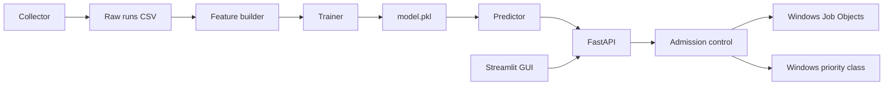

# AI Resource Allocation Engine

## What it does

The engine predicts an application's CPU, memory, disk-I/O, and network needs from its name and historical measurements before launching it. It can reject runs that exceed current resource headroom, then launch configured workloads and compare their predictions with observed usage. On Windows, it can apply process priority classes and, when pywin32 Job Objects are available, CPU and memory limits.

## Architecture



The collector runs the workloads listed in `collector/apps_config.yaml` and records process-tree resource measurements. The feature builder uses prior valid runs as historical features, then writes the training dataset and serving profiles; the trainer saves its model bundle to `model/artifacts/model.pkl`. FastAPI uses the model when the bundle exists (or the deterministic mock predictor otherwise), and the Streamlit GUI calls the API.

The diagram shows the current Windows integration. The project plan in `vibe.md` describes a Linux cgroups v2 counterpart (`cpu.max`, `memory.max`, and `cgroup.procs`), but that is a design reference, not a supported or implemented runtime here.

## Requirements

- Windows 10 or Windows 11.
- Python 3.11 or newer available as `python` on `PATH`.
- PowerShell.
- Python packages in `requirements.txt`, installed by `.\tasks.ps1 setup`.
- **Optional enforcement dependency:** `pywin32` is not in `requirements.txt`. Install it to enable Windows Job Object CPU and memory limits. Without it, the API can still run applications but reports that the caps were not applied.
- **External workload executable:** `ffmpeg.exe` on `PATH` is used by `ffmpeg_encode`. It is not a Python dependency. Although ffmpeg is optional to the general engine, the current `collector/apps_config.yaml` does not mark this app optional; the app loader can therefore fail if ffmpeg is missing. Install ffmpeg or explicitly mark `ffmpeg_encode` optional in that configuration before running collection.
- `edge_headless` is already marked optional and is skipped when its executable is unavailable.

The project targets Python 3.11+, but the active virtual environment and commands below should use the interpreter available on your machine. Verify it with `python --version`.

## Setup

Open PowerShell in the project root. The task script invokes the virtual environment's Python directly, so activation is not needed:

```powershell
python --version
.\tasks.ps1 setup
```

For Windows Job Object enforcement, install pywin32 into that environment:

```powershell
.\.venv\Scripts\python.exe -m pip install pywin32
```

Check that ffmpeg is discoverable when using the configured `ffmpeg_encode` workload:

```powershell
Get-Command ffmpeg -ErrorAction SilentlyContinue
ffmpeg -version
```

## Quick start

Run the data and model tasks in this order. Initial collection runs the configured workloads until each has eight valid records; it can take a while and includes network, CPU, disk, and memory workloads.

```powershell
.\tasks.ps1 setup
.\tasks.ps1 collect
.\tasks.ps1 dataset
.\tasks.ps1 train
.\tasks.ps1 eval
```

`collect` creates or resumes `data/raw/runs.csv`. `dataset` requires that file and creates `data/processed/dataset.csv` and `data/processed/app_profiles.csv`. Training writes `model/artifacts/model.pkl`, and evaluation writes reports under `reports/`.

Launch the desktop application:

```powershell
.\tasks.ps1 gui
```

The Tkinter window starts the local API if it is not already running. Select a configured workload or an installed application from the list, or use **Browse .exe...** to choose an executable. Newly selected apps are registered locally; they need history before the model can predict them. **Prepare selected app** collects up to eight valid runs (launching the app with no arguments and stopping each attempt after 15 seconds), rebuilds the dataset, trains the model, and evaluates it. The comparison view includes predicted-versus-actual charts, an error table, enforcement details, and recent comparisons. The GUI stops the API on close only when it started that API itself.

The API listens only on `http://127.0.0.1:8000` and supports `GET /health`, `POST /predict`, and `POST /run-and-compare`. To start the API separately, use `.\tasks.ps1 api`. For example:

```powershell
Invoke-RestMethod -Uri "http://127.0.0.1:8000/predict" -Method Post -ContentType "application/json" -Body '{"app_name":"cpu_burn"}'
```

Run the end-to-end smoke workflow when data has been collected. It rebuilds the dataset, retrains and evaluates the model, starts its own API on a free local port, exercises predictions and a short `cpu_burn` run, then stops the API:

```powershell
.\tasks.ps1 e2e
```

## How enforcement works on Windows

The API serializes `/run-and-compare` runs within one process and checks admission before launching a configured app. Its RAM check compares predicted memory with a 2× margin against available RAM minus a 1,024 MB reserve. It refuses a prediction of at least 100% CPU when recent system CPU usage is above 90%. These policies can be affected by `RESERVE_RAM_MB` and `ENFORCEMENT` environment variables.

The predicted CPU demand selects a Windows priority class: normal below 60%, below-normal from 60%, and idle from 150%. When pywin32 is available, the API creates a Job Object for the launched process, applies a hard CPU-rate cap and a job committed-memory limit, and enables kill-on-close. The CPU cap is derived from the predicted CPU demand with a 1.5× margin, bounded to 0.25 through the machine's logical core count; the memory limit uses 2× predicted RAM with a 128 MB minimum. A Job Object memory limit is based on committed memory, not the process-tree RSS metric. If Job Objects are unavailable, workload execution can continue without CPU or memory caps, with that outcome reported in the response.

These mechanisms correspond conceptually to the Linux cgroups v2 design in `vibe.md`: the Windows CPU rate cap maps to `cpu.max`, the Job Object memory limit maps to `memory.max`, and Job Object membership/process-tree control maps to `cgroup.procs`. Linux `memory.high` and cgroup accounting have no direct equivalent implemented here. The Linux setup design requires enabling controllers and elevated permissions; it does not apply to this Windows implementation.

Normal-priority changes and Job Objects for processes spawned by this application generally do not require administrator rights. Job creation or assignment can still fail because of Windows/host restrictions or an incompatible parent Job Object. The application reports that as unavailable or an API error; elevating the API is not a guaranteed remedy.

## Desktop GUI

The Tkinter GUI is launched with `.\tasks.ps1 gui`. It provides an installed/configured-app selector, an executable browser, prediction gauges, historical per-run trends, a min/average/max prediction-range view, predicted-versus-actual charts, an error summary, enforcement details, and recent comparison history. Installed-app discovery uses Windows application registry entries; some apps may only be available through **Browse .exe...**. Selected executable paths are stored in the ignored local file `data/user_apps.yaml`. The API starts automatically when needed. Its base URL can be overridden with `API_URL`; the default is `http://127.0.0.1:8000`.

## Tests

Run the test suite from the project root:

```powershell
.\tasks.ps1 test
```

The suite includes unit tests for schemas, feature leakage, monitoring, admission, API behavior, and simulated Job Object operations. Tests that require actual Windows Job Object capability may be skipped when that capability is unavailable. The coverage plugin is not listed in `requirements.txt`; to generate a coverage report, install it into the venv first:

```powershell
.\.venv\Scripts\python.exe -m pip install pytest-cov
.\.venv\Scripts\python.exe -m pytest --cov=. --cov-report=term-missing
```

## Project layout

```text
.
|-- collector/                 Workload configuration, launcher, monitor, and run logger
|   `-- workloads/              CPU, memory, disk, sort, and compile benchmark programs
|-- data/
|   |-- raw/                    Collected run measurements (generated; CSVs are ignored by Git)
|   |-- sample/                 Sample dataset and sample-data generator
|   `-- processed/              Training dataset and serving profiles (generated)
|-- docs/                       API and feature/target contract
|-- features/                   Leakage-safe feature and profile builder
|-- gui/                        Tkinter desktop app and API client
|-- model/                      Training, evaluation, and prediction code
|   `-- artifacts/              Serialized trained model bundle (generated)
|-- os_integration/             Admission policy, Windows Job Objects, and priority handling
|-- reports/                    Model evaluation reports
|-- scripts/                    End-to-end workflow runner
|-- service/                    FastAPI app, schemas, and mock predictor
|-- tests/                      Pytest suite
|-- config.py                   Repository-root path helper and shared schemas
|-- requirements.txt            Python package requirements
`-- tasks.ps1                   PowerShell task dispatcher
```

## Troubleshooting

- **PowerShell blocks `Activate.ps1` or `tasks.ps1`:** Activation is not needed; `tasks.ps1` calls the venv interpreter explicitly. If local policy blocks the task script and your machine permits a process-scoped override, run this in the current PowerShell session, then retry:

  ```powershell
  Set-ExecutionPolicy -Scope Process -ExecutionPolicy Bypass
  .\tasks.ps1 help
  ```

  Follow your organization's execution-policy requirements if policy changes are restricted.
- **Job Objects are unavailable / pywin32 is missing:** Install pywin32 in `.venv` with the command in Setup. Restart the API afterward. The API may still run workloads without caps if Job Objects remain unavailable.
- **`ffmpeg` is not on `PATH`:** Install FFmpeg, add its `bin` directory to `PATH`, open a new PowerShell window, and verify with `Get-Command ffmpeg`. The current app configuration treats `ffmpeg_encode` as required, so app loading may fail until it is present or marked optional.
- **Port 8000 is already in use:** Stop the API instance you started before launching another. Inspect the listener with `Get-NetTCPConnection -LocalPort 8000 -State Listen`; do not terminate an unfamiliar process. The `e2e` task chooses a free port for its own API.
- **Defender or other background activity adds measurement noise:** Close unnecessary applications, pause downloads and syncing, and avoid interacting with the machine during collection. Do not disable Defender; rerun noisy measurements under similar conditions.
- **Job assignment fails:** Confirm pywin32 is installed and the API is running as the same normal user that started the app. Host restrictions or nested Job Object policies can prevent assignment even when pywin32 is installed. Check the API error/response; without successful Job Object attachment, CPU and memory caps were not applied.

## Known limitations

- Network throughput is measured from system-wide counters because psutil does not expose per-process network counters. Other applications' traffic can contaminate it.
- On Windows, process I/O counters include files, pipes, network, and devices, so reported disk throughput can overstate actual disk traffic.
- Process-tree CPU can exceed 100% on multi-core machines; RAM is peak summed RSS. A Job Object's memory cap instead applies to committed memory.
- Predictions depend on having valid historical runs and serving profiles for each configured app. The model is only as representative as the collected workload history.
- Collection runs sequential, potentially resource-intensive workloads; the network workload downloads data and measurements vary with machine load and background activity.
- Windows enforcement is optional and may not be available in restricted environments. This repository does not implement the Linux cgroups v2 design as an alternative runtime.
- The API is configured for local access, has no authentication, and serializes comparison runs only within one application process. Do not expose it to an untrusted network.
